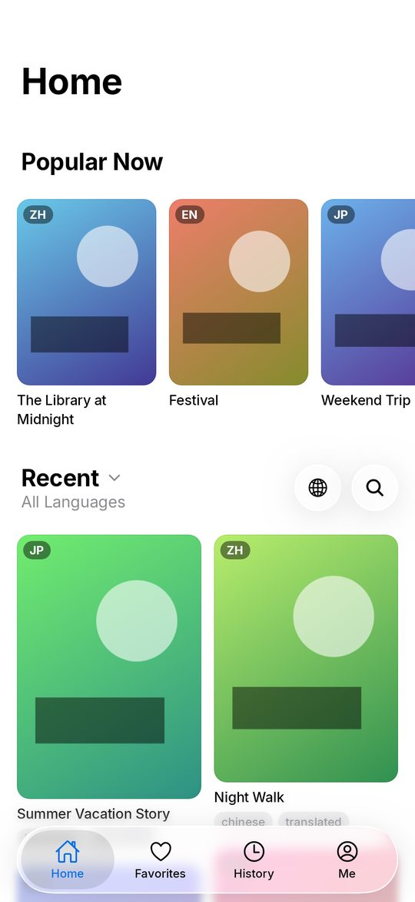
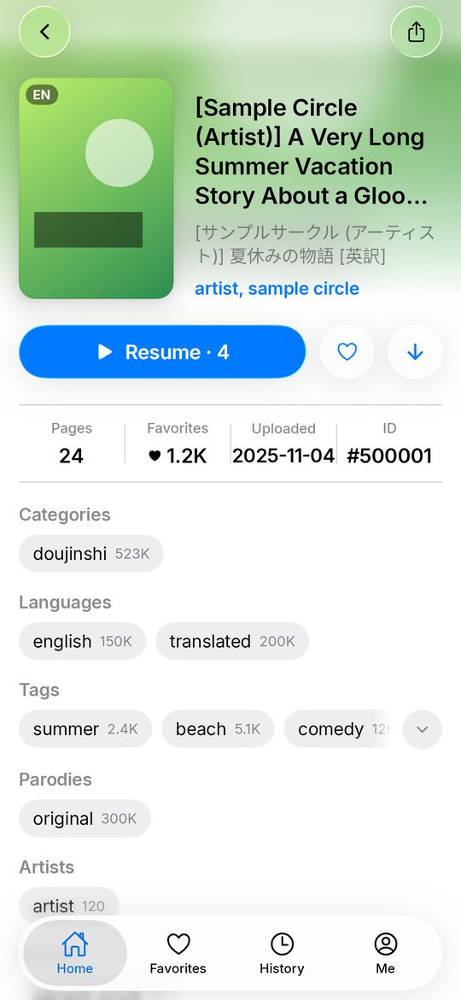
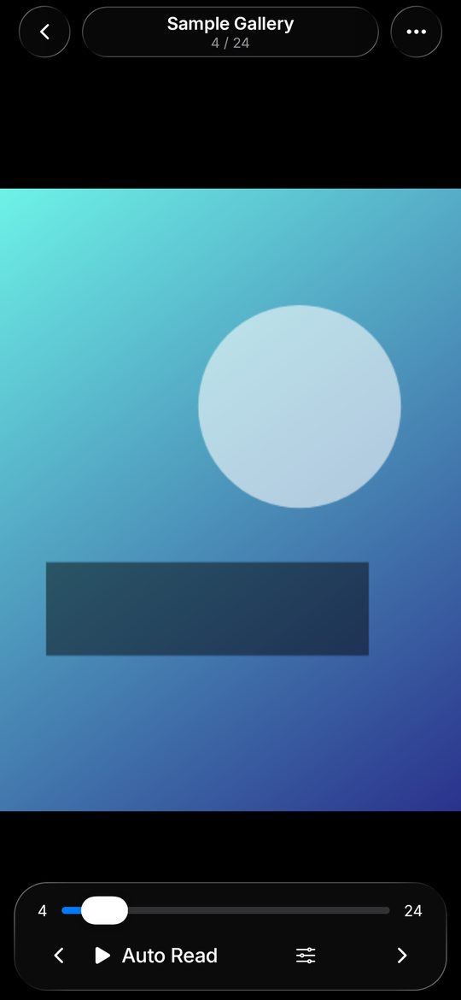
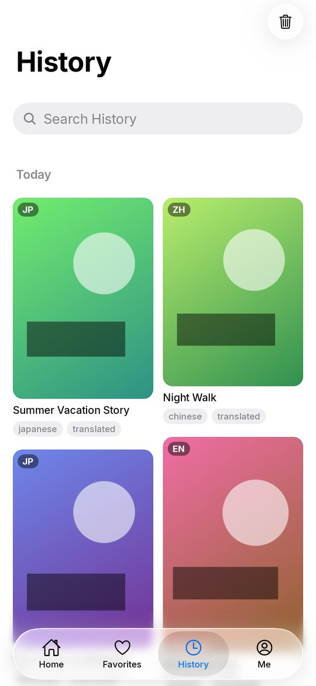
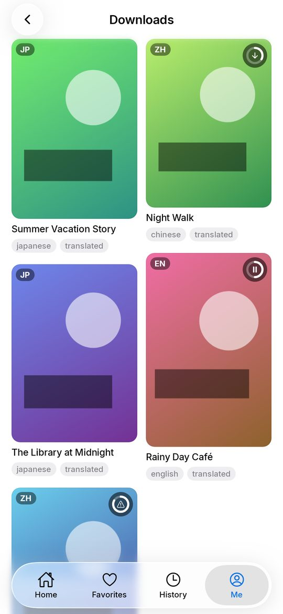
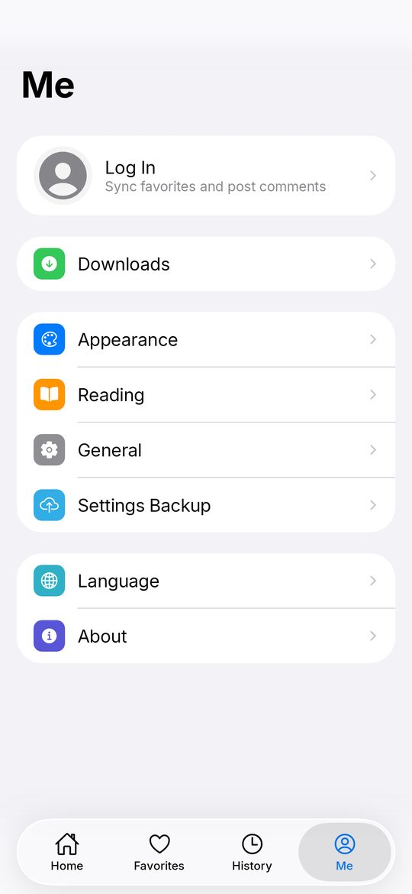

<p align="center">
  
</p>

<h1 align="center">AEros-NHT</h1>

<p align="center">
  非官方 nhentai 客户端：原生 iPhone / iPad（SwiftUI）和 Android（Kotlin、Jetpack Compose）App，<br>
  Apple 风格界面与 Liquid Glass，两个平台功能一致。
</p>

<p align="center">
  简体中文 · <a href="README_en.md">English</a>
</p>

## 下载

在 [Releases](https://github.com/AtlanYuey/AEros-NHT/releases/latest) 下载最新版本：

| 设备 | 文件 | 要求 |
| --- | --- | --- |
| iPhone / iPad | `.ipa` | iOS / iPadOS 18 或更高版本（iOS 26 上使用 Liquid Glass）。安装包未签名，请用 Feather、SideStore、AltStore、Sideloadly 等工具自行签名安装 |
| Android 手机 / 平板 | `.apk` | Android 8.0 或更高版本，直接安装，以后的版本可以覆盖更新 |

## 截图

以下是 Android 版的截图，封面和页面都是示例图片。

| 首页 | 画廊 | 阅读器 |
| :---: | :---: | :---: |
|  |  |  |
| **历史** | **下载** | **我的** |
|  |  |  |

## 功能

- **首页**：热门与最新，按语言、排序筛选；瀑布流、紧凑瀑布流、网格、列表四种样式，横竖屏可分别设置卡片大小
- **搜索**：在首页原地搜索；标签补全、搜索历史，输入作品编号直接显示该作品
- **画廊页**：分组标签（可显示中文翻译）、页面预览、相似推荐、评论
- **阅读器**：从左到右、从右到左、上下翻页、上下连续（条漫，可带间距）；缩放、自动阅读、预加载，控制栏自动隐藏
- **收藏、历史、下载**：卡片或列表显示；离线下载，没有网络时也能打开详情页阅读
- **账号**：登录 nhentai 账号后可以收藏、发表评论
- **界面**：Liquid Glass 标签栏和按钮；iPad 和 Android 平板的标签栏可固定靠左、居中、靠右，或跟随惯用手
- **设置**：14 种界面语言；设置可以导出、导入（两个平台通用），iOS 上可通过 iCloud 同步

## 自己编译

### iOS / iPadOS（`apple/`）

需要 Xcode 26 和 [XcodeGen](https://github.com/yonaskolb/XcodeGen)：

```sh
cd apple
xcodegen generate
open ErosN.xcodeproj
```

### Android（`android-native/`）

需要 JDK 21 和 Android SDK 37：

```sh
cd android-native
./gradlew :app:assembleDebug        # 调试版 APK
./gradlew :app:testDebugUnitTest    # 截图测试，输出到 app/build/screens
```

正式版的签名方式见 [android-native/README.md](android-native/README.md)。

### 发布

提交说明里带 `[publish]` 时，[native-release.yml](.github/workflows/native-release.yml) 会构建两个 App。Android 版先在模拟器（Android 11、12、13、16）上运行测试，通过后发布一个同时包含 IPA 和 APK 的 GitHub Release，说明取自 [RELEASE_NOTES.md](RELEASE_NOTES.md)。

## 目录

| 目录 | 内容 |
| --- | --- |
| `apple/` | iOS / iPadOS App（SwiftUI） |
| `android-native/` | Android App（Kotlin、Jetpack Compose） |
| `design/app-icon/` | App 图标的生成脚本 |
| `.github/workflows/` | 构建、模拟器测试和发布 |

旧的 Flutter 版保存在 [`flutter` 分支](https://github.com/AtlanYuey/AEros-NHT/tree/flutter)。

## 许可与致谢

本项目是 [honjow/eros_n](https://github.com/honjow/eros_n) 的修改版（Apache License 2.0，见 [LICENSE](LICENSE)），由 [AtlanYuey](https://github.com/AtlanYuey) 维护，与原作者及 nhentai 均无关联。标签数据来自 [nhentai_tags_fetcher](https://github.com/honjow/nhentai_tags_fetcher)，中文翻译来自 [EhTagTranslation](https://github.com/EhTagTranslation/Database)。其他第三方组件的许可见 App 内「关于 › 开源许可」。

仅供 18 岁以上用户使用。
