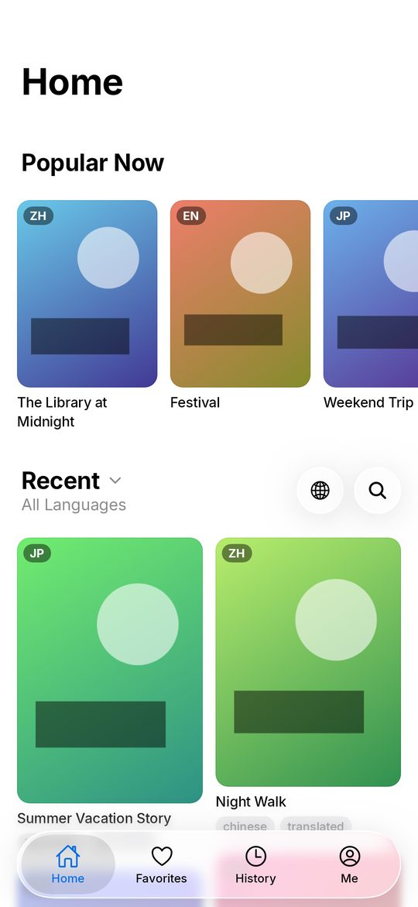
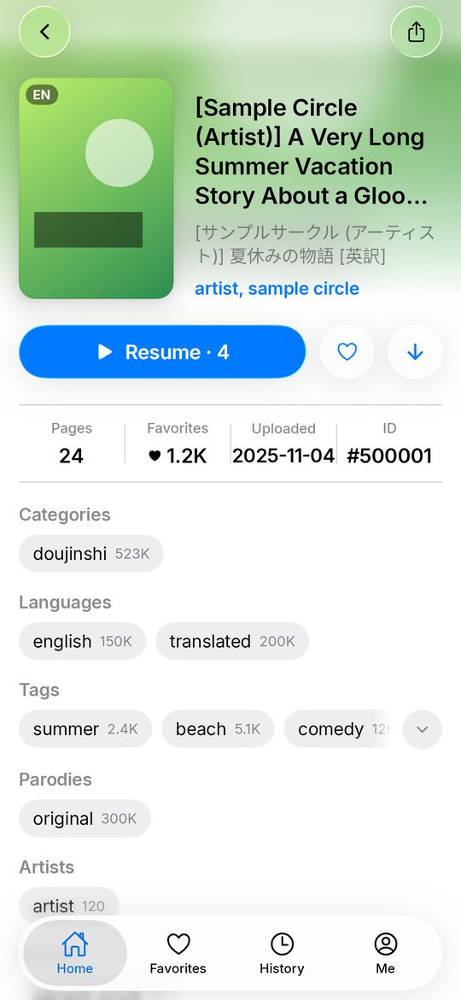
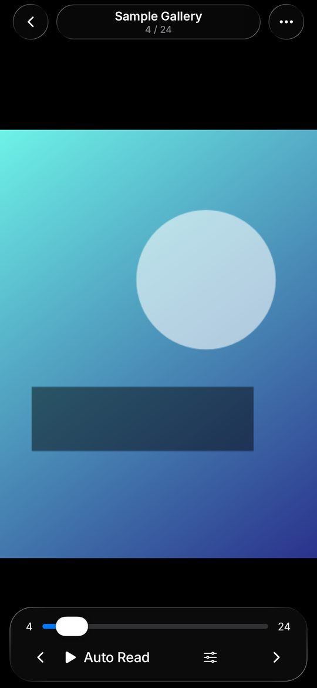
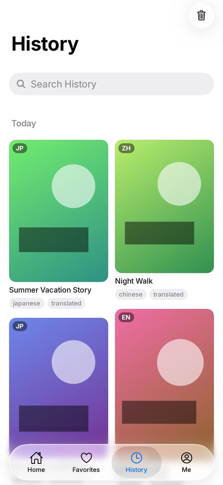
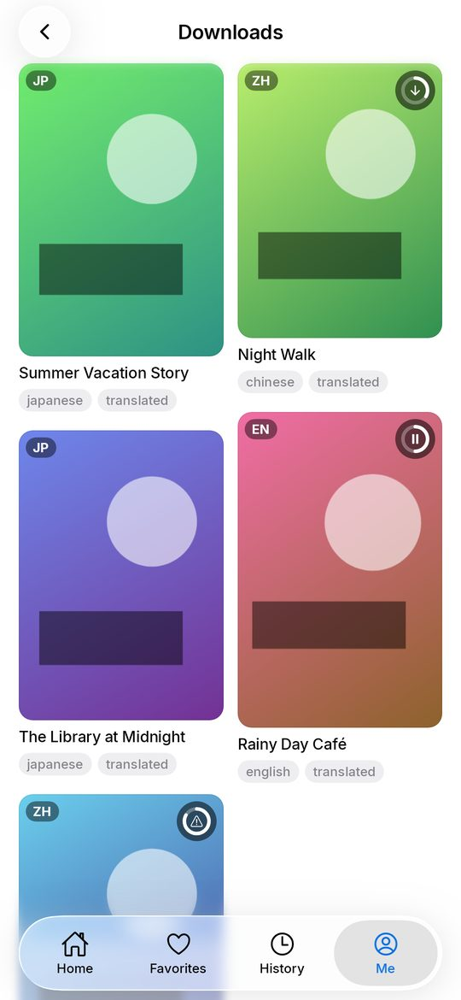
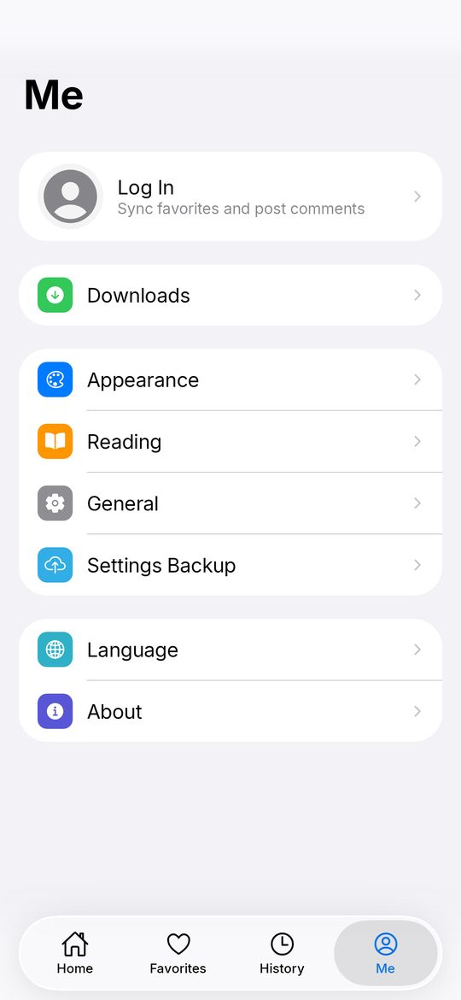

<p align="center">
  
</p>

<h1 align="center">AEros-NHT</h1>

<p align="center">
  An unofficial nhentai client: native apps for iPhone / iPad (SwiftUI) and Android (Kotlin, Jetpack Compose),<br>
  with an Apple-style design and Liquid Glass, and the same features on both.
</p>

<p align="center">
  <a href="README.md">简体中文</a> · English
</p>

## Download

Get the latest version from [Releases](https://github.com/AtlanYuey/AEros-NHT/releases/latest):

| Device | File | Requirements |
| --- | --- | --- |
| iPhone / iPad | `.ipa` | iOS / iPadOS 18 or later (Liquid Glass on iOS 26). The IPA is unsigned: sign and install it with Feather, SideStore, AltStore, Sideloadly or similar |
| Android phone / tablet | `.apk` | Android 8.0 or later. Install it directly; later versions update over it |

## Screenshots

From the Android app, with sample covers and pages.

| Home | Gallery | Reader |
| :---: | :---: | :---: |
|  |  |  |
| **History** | **Downloads** | **Me** |
|  |  |  |

## Features

- **Home**: popular and recent galleries, filtered by language and sorted; waterfall, compact waterfall, grid and list styles, with card sizes for portrait and landscape
- **Search**: right on the Home page, with tag suggestions and search history; a gallery number shows that gallery
- **Gallery page**: grouped tags (optionally translated to Chinese), page previews, similar galleries, comments
- **Reader**: left to right, right to left, top to bottom, continuous (webtoon, with or without gaps); zoom, auto reading, preloading, controls that hide on their own
- **Favorites, History, Downloads**: cards or a list; offline downloads whose gallery page also opens without the network
- **Account**: log in to nhentai to keep favorites and post comments
- **Design**: Liquid Glass tab bar and buttons; on iPad and Android tablets the tab bar sits left, center or right, or follows the hand in use
- **Settings**: 14 languages; settings export and import (the file works on both platforms) and sync over iCloud on iOS

## Building

### iOS / iPadOS (`apple/`)

Needs Xcode 26 and [XcodeGen](https://github.com/yonaskolb/XcodeGen):

```sh
cd apple
xcodegen generate
open ErosN.xcodeproj
```

### Android (`android-native/`)

Needs JDK 21 and the Android SDK 37:

```sh
cd android-native
./gradlew :app:assembleDebug        # debug APK
./gradlew :app:testDebugUnitTest    # screenshot tests, written to app/build/screens
```

Release signing is described in [android-native/README.md](android-native/README.md).

### Releasing

A commit whose message contains `[publish]` makes [native-release.yml](.github/workflows/native-release.yml) build both apps, run the Android app on emulators (Android 11, 12, 13 and 16), and, when that passes, publish one GitHub release with the IPA and the APK, described by [RELEASE_NOTES.md](RELEASE_NOTES.md).

## Layout

| Folder | Contents |
| --- | --- |
| `apple/` | the iOS / iPadOS app (SwiftUI) |
| `android-native/` | the Android app (Kotlin, Jetpack Compose) |
| `design/app-icon/` | builds the app icon |
| `.github/workflows/` | builds, emulator tests and releases |

The former Flutter app is kept on the [`flutter` branch](https://github.com/AtlanYuey/AEros-NHT/tree/flutter).

## License and credits

AEros-NHT is a modified version of [honjow/eros_n](https://github.com/honjow/eros_n) (Apache License 2.0, see [LICENSE](LICENSE)), maintained by [AtlanYuey](https://github.com/AtlanYuey). It is not affiliated with the original author or with nhentai. Tags come from [nhentai_tags_fetcher](https://github.com/honjow/nhentai_tags_fetcher) and their Chinese translations from [EhTagTranslation](https://github.com/EhTagTranslation/Database). Licenses of other third-party components are listed in the app under About › Open Source Licenses.

For adults (18+) only.
